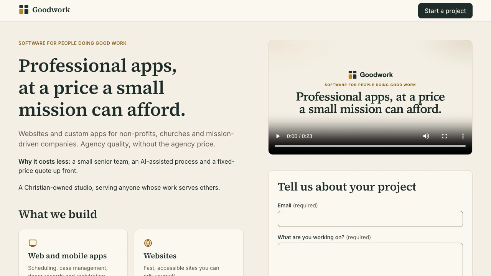

# Goodwork demo video

One narrated video that walks through every user journey the Goodwork site implements, recorded as a
single continuous take against the real app (Angular app, .NET API, SQLite, background delivery job).



## Applications

| Application | Purpose | Status |
| --- | --- | --- |
| [Goodwork website](goodwork.webm) | Brochure page and contact request form, served by the API | Recorded |

The API and the migrate CLI are parts of that one application, not separate user-facing apps, so they have
no video of their own.

## The recording

| | |
| --- | --- |
| File | [`goodwork.webm`](goodwork.webm), 22.2 MB |
| Length | 3 min 17 s (197.5 s) |
| Video | VP9, 1280 x 720 |
| Audio | Opus, 48 kHz mono, loudness-normalized (about -17 dB mean, -1.1 dB peak) |
| Narrator | `en-US-AvaMultilingualNeural` (Microsoft Edge neural voice via `edge-tts`), rate +8%, pitch +3 Hz |
| Poster | [`goodwork-poster.png`](goodwork-poster.png), a frame extracted from the finished video |
| Narration text | [`goodwork-narration.md`](goodwork-narration.md); the same paragraphs become on-screen captions when recorded with `node demo/record.mjs --captions` (off by default) |
| Pronunciations | [`pronunciations.json`](pronunciations.json) |

## Chapters and the journeys they show

| Time | Chapter | What is shown (requirements) |
| --- | --- | --- |
| 0:00 | Welcome | Opening card |
| 0:11 | Meet Goodwork | Hero, cost explanation, Christian-owned line, the two services (L2-001) |
| 0:48 | Light and dark | The page switching colour scheme without a reload (L2-013) |
| 1:00 | On a phone | A 360 x 640 viewport: single column, no sideways scroll (L2-012) |
| 1:11 | Keyboard only | Skip link, focus ring, Enter to jump to content, tab order into the form (L2-002, L2-014) |
| 1:29 | Start a project | The header button scrolls to the form and focuses the email field (L2-002) |
| 1:38 | Fixing mistakes | Empty submit, focused error summary, summary link focuses the field, error clears live as the email is typed (L2-004) |
| 2:01 | Sending a request | Busy "Sending..." state, read-only fields, "Request sent" confirmation; the row is checked in SQLite before the narration claims success (L2-005, L2-006, L2-008) |
| 2:19 | Sending another | "Send another request" gives an empty form (L2-006) |
| 2:32 | Protection from spam | The sixth request in ten minutes is refused by the real rate limiter (HTTP 429); the form keeps the message and offers the studio email; the refused request is checked as not stored (L2-007, L2-010) |
| 2:43 | It reaches the studio | The delivery job's real email, read from the outbox, shown on screen with its reply-to (L2-009) |
| 3:05 | Thank you | Closing card |

## Disclosures

- **Four earlier requests were sent through the public API before recording starts** so that the on-screen
  "another request" is genuinely the sixth within the ten-minute window. The narration says so.
- **The "slow connection" is real throttling.** A 3 s network latency is applied through the browser's
  developer protocol for the send step only, so the busy state is visible. No response is mocked.
- **Delivery runs on a 30 s timer.** The take overlaps that wait with narration. Email goes to a pickup
  folder (`Smtp:PickupDirectory`), not a real mail server.
- **Placeholders:** the location ("Toronto, Ontario"), the contact email and the studio inbox
  (`studio@goodwork.test`) are placeholders, not confirmed Goodwork details.
- **Known copy gap, shown as-is:** the rate-limit refusal displays "Our mail service didn't respond", the
  generic error text from the mock. That wording is inaccurate for a rate limit; the narration describes
  only what the form does. Worth a product decision.
- **The phone view** is a literal 360 x 640 viewport on the 1280 x 720 recording, so it sits at the left on
  a grey field.
- **Covered by tests but not shown** (no real trigger without mocking or changing the product): the 503 and
  network-failure variants of the error state, server-side field errors, the 24-month retention job.
- **Size:** the video stream is Playwright's own capture, copied unchanged into the final file, so it is large
  for a three-minute video. The repository has no Git LFS configured.

While preparing the demo, the self-hosted fonts turned out not to be applied (the variable font packages
register different family names than the design tokens use). That was fixed in the app and covered by a
stricter test in `e2e/specs/performance.spec.ts`; the video shows the corrected fonts.

## Rerun

Prerequisites: .NET SDK 10, Node 24, `ffmpeg` and `ffprobe` (with libvpx-vp9 and libopus), `sqlite3`,
Python 3 with a venv holding `edge-tts`, internet access for voice synthesis, and Playwright's Chromium.

```sh
cd e2e
npm ci && npx playwright install chromium
python3 -m venv .demo-run/venv && .demo-run/venv/bin/pip install edge-tts

node demo/synthesize.mjs      # one voice clip per narration paragraph (cached by text, voice, rate, pitch)
node demo/record.mjs          # builds the app, records one continuous take (about 4 minutes)
node demo/assemble.mjs        # aligns narration, muxes Opus, derives chapters and the poster
node demo/assemble.mjs --promote   # also copies the video and poster into docs/demo (backs up previous files)
```

Settings: `EDGE_VOICE`, `EDGE_RATE`, `EDGE_PITCH` override the voice. Edit `docs/demo/goodwork-narration.md`
to change what is said; edit `e2e/demo/record.mjs` to change what is done. Re-record the whole take after
any change; do not splice takes.

Data and cleanup: the take uses a disposable SQLite database, outbox, web root and venv under
`e2e/.demo-run/` (git-ignored) and an API process on a free local port. On exit it stops only that API process
and removes the empty `wwwroot` folder it may have created. Nothing else is reset or deleted.
The recording is not part of the acceptance run.
