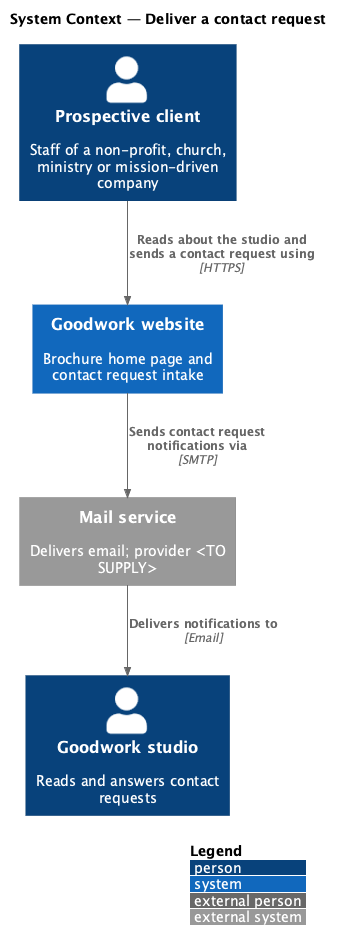
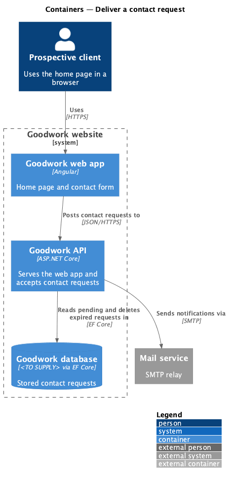
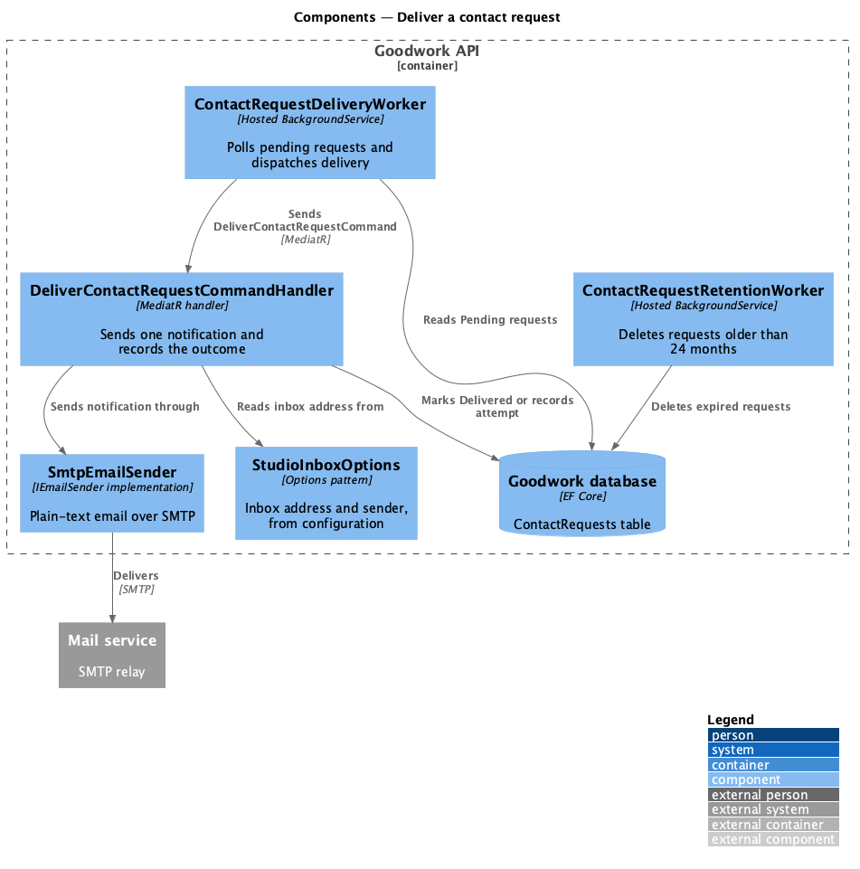
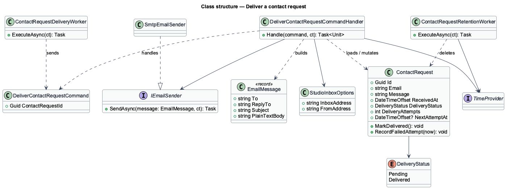
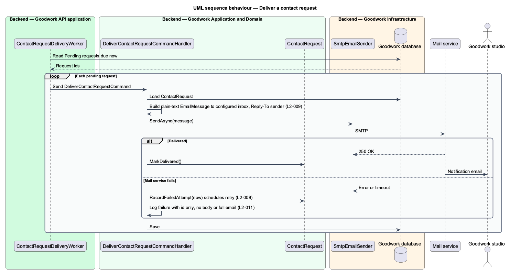
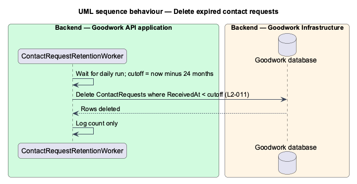

# Deliver a contact request

## Overview

A contact request accepted by `contact/submit-contact-request` is stored with the delivery status `Pending`. This feature takes each pending request to the studio and later removes it once it is older than the retention period.

**studio inbox** — email address, read from configuration, where the studio receives contact requests

**delivery status** — state of a stored contact request: `Pending` until its notification is sent, then `Delivered`

**retention period** — time a contact request is kept before deletion: 24 months

Delivery runs in the background, so a slow or failing mail service never delays the visitor's response. A failed send leaves the request stored and schedules a retry. The studio promises a reply within two business days, and this feature is how a request reaches someone who can give that reply.

The mocks leave open where requests go (email inbox, CRM or both). This design delivers to one email inbox. A CRM integration is `<TO SUPPLY>`.

## Description

The slice runs inside the Goodwork API process, between the database and the mail service.

- **`ContactRequestDeliveryWorker`** — hosted `BackgroundService` in `Goodwork.Api`. It polls for `Pending` requests whose next attempt is due and sends one `DeliverContactRequestCommand` per request. The poll interval is `<TO SUPPLY>`.
- **`DeliverContactRequestCommandHandler`** — MediatR handler in `Goodwork.Application`. It loads the request and builds a plain-text `EmailMessage` addressed to the studio inbox, with `Reply-To` set to the sender. It sends the message through `IEmailSender`, then marks the request delivered or records a failed attempt.
- **`EmailMessage`** — record of recipient, reply-to address, subject and plain-text body. The body contains the sender's email and message verbatim, with no HTML.
- **`IEmailSender`** and **`SmtpEmailSender`** — abstraction in `Goodwork.Application` and its SMTP implementation in `Goodwork.Infrastructure`. Tests replace the implementation with a fake. The mail provider is `<TO SUPPLY>`.
- **`StudioInboxOptions`** — options bound from configuration. They hold the inbox and sender addresses. No address appears in source.
- **`ContactRequest`** — domain entity from `contact/submit-contact-request`. `MarkDelivered()` sets the status to `Delivered`. `RecordFailedAttempt(now)` increments the attempt count and sets `NextAttemptAt`. The backoff schedule and maximum attempt count are `<TO SUPPLY>`.
- **`ContactRequestRetentionWorker`** — hosted `BackgroundService`. It runs daily and deletes requests whose `ReceivedAt` is more than 24 months before now.
- **`TimeProvider`** — .NET time abstraction. Both workers and the handler read time through it so tests can control it.

Logs from this slice name a request by its id. They shall not contain the message body or the full email address.

## Requirements

The feature realizes the following level-2 (L2) requirements. Each L2 requirement refines a level-1 (L1) requirement, cited by identifier.

| L2 ID | Refines (L1) | Requirement |
|-------|--------------|-------------|
| `L2-009` | `L1-003` | Each stored request shall be emailed to the configured studio inbox with Reply-To set to the sender, retried on mail failure without loss, and reported as 503 if it cannot be stored. |
| `L2-011` | `L1-004` | Logs shall never contain the message body or the full email address, and stored requests older than 24 months shall be deleted. |

`L2-011` also covers HTTPS and security headers, which `site/view-home-page` realizes. The 503-on-storage-failure criterion of `L2-009` is realized in `contact/submit-contact-request`.

## Diagrams

### System context

The Goodwork website forwards each contact request to the studio through an external mail service.

### Containers

The Goodwork API reads pending requests from the Goodwork database and sends notifications through the mail service over SMTP.

### Components

`ContactRequestDeliveryWorker` dispatches one command per pending request. `DeliverContactRequestCommandHandler` sends through `SmtpEmailSender` to the inbox named by `StudioInboxOptions`. `ContactRequestRetentionWorker` deletes expired requests.

### Class structure

The handler depends on `IEmailSender`, `StudioInboxOptions` and `TimeProvider`, and mutates `ContactRequest` through `MarkDelivered()` and `RecordFailedAttempt(now)`.

### Behaviour — deliver a pending request

For each due request, the handler sends a plain-text notification. A success marks the request delivered. A failure records the attempt and schedules a retry.

### Behaviour — delete expired requests

Once a day the retention worker deletes requests received more than 24 months earlier and logs only the count.

