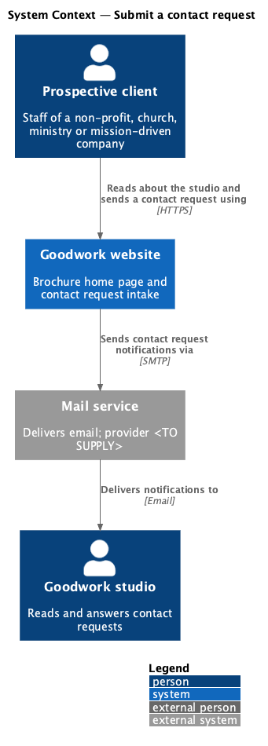
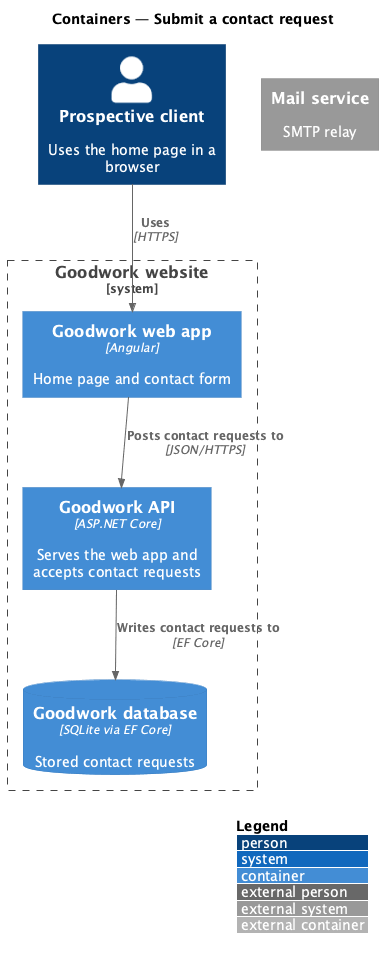
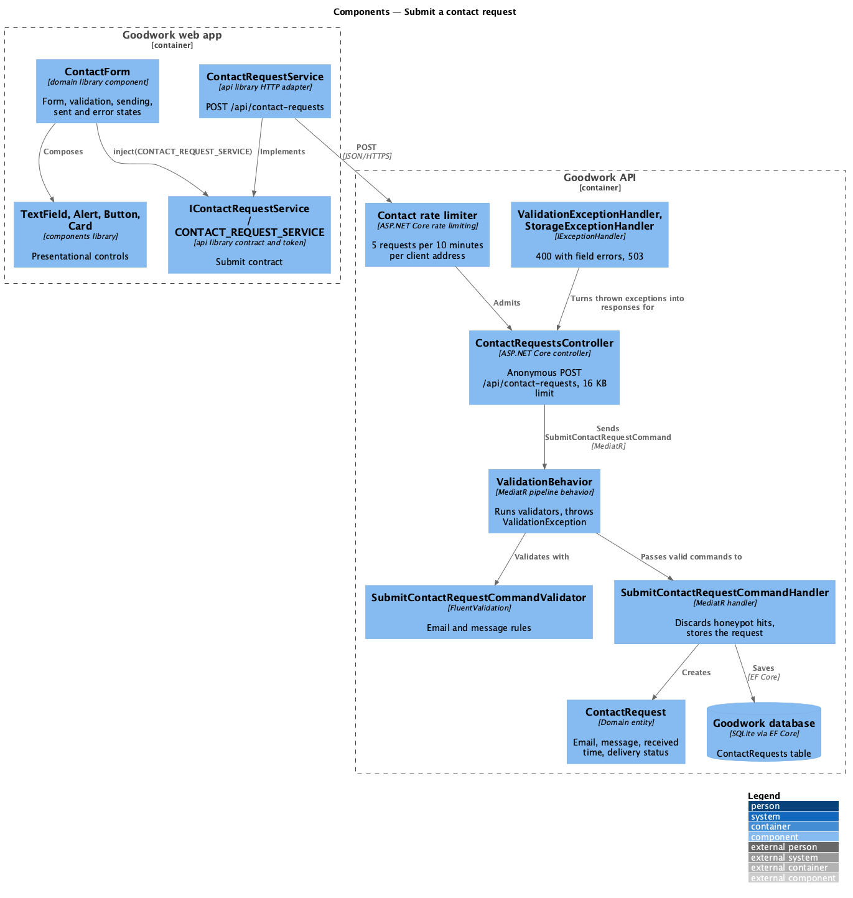
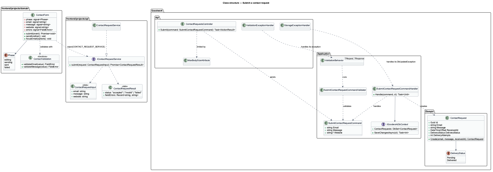
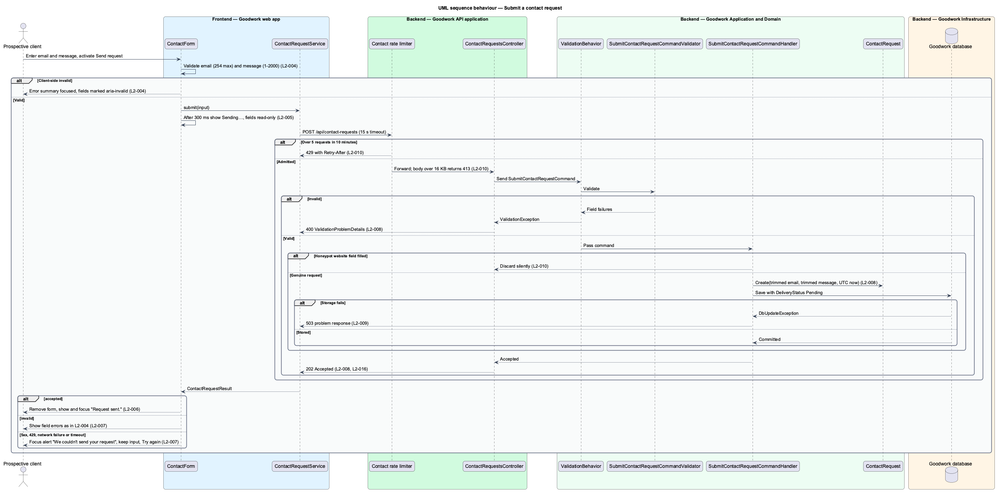

# Submit a contact request

## Overview

The Goodwork home page ends with a short form that lets a prospective client ask the studio about a project. This feature covers that form and the API endpoint that accepts it.

**contact request** — enquiry from a prospective client, made of an email address and a short message

**honeypot field** — form input hidden from people, which automated spam submitters tend to fill

The form asks only for an email address and a message. A visitor sees one of five states: default, invalid, sending, sent and error. A submission the server accepts is stored at once. Delivery to the studio inbox happens afterwards, outside the request, and is covered by `contact/deliver-contact-request`.

The endpoint is the only anonymous endpoint in the API. It is opted into anonymous access explicitly, rate-limited and size-limited.

The design references are the five mocks in `docs/mocks/pages/home/`.

## Description

The slice runs from the `ContactForm` component to the `ContactRequests` table.

- **`ContactForm`** — component in the `domain` library. It holds its state in signals: the field values, the field errors, and a phase of `editing`, `sending`, `sent` or `failed`. It validates on submit, then live per field once a field has shown an error. It delays the busy state by 300 ms, removes the form once a request is sent, and exposes `focusEmail()` for the "Start a project" link. It renders an off-screen `website` input as the honeypot field.
- **`validateEmail`** and **`validateMessage`** — pure functions in `domain` that return a `FieldError` (a short summary text and a full detail text) or nothing. They apply the 254 and 2000 character limits.
- **`TextField`, `Alert`, `Button`, `Card`** — presentational components from the `components` library. `ContactForm` composes every control from them.
- **`IContactRequestService`** and **`CONTACT_REQUEST_SERVICE`** — contract and injection token in the `api` library. The form depends only on the token.
- **`ContactRequestService`** — HTTP implementation in the `api` library. It posts to `/api/contact-requests` with a 15 s timeout and maps responses to a `ContactRequestResult`: 202 to `accepted`, 400 to `invalid` with field errors, and any other outcome to `failed`.
- **Contact rate limiter** — ASP.NET Core fixed-window policy of 5 requests per 10 minutes per client address. It rejects excess requests with 429 and `Retry-After`.
- **`MaxBodySizeAttribute`** — resource filter on the endpoint. It answers 413 when the declared `Content-Length` exceeds 16 KB and sets the server's own limit for chunked bodies.
- **`ContactRequestsController`** — controller in `Goodwork.Api.Controllers`. It binds the body, sends the command through MediatR and returns 202. It carries `[AllowAnonymous]`, the rate-limit policy and the size limit.
- **`SubmitContactRequestCommand`** — command carrying `Email`, `Message` and the optional honeypot `Website`. Unknown properties are not bound.
- **`ValidationBehavior`** — MediatR pipeline behavior in `Goodwork.Application`. It runs every validator for a request and throws a `ValidationException` when any rule fails.
- **`SubmitContactRequestCommandValidator`** — FluentValidation validator in `Goodwork.Application`. Email shall be a complete address of at most 254 characters after trimming. Message shall contain a non-whitespace character and at most 2000 characters after trimming.
- **`ValidationExceptionHandler`** — exception handler in `Goodwork.Api`. It turns a `ValidationException` into a 400 `ValidationProblemDetails` whose `errors` are keyed by camel-case field name.
- **`StorageExceptionHandler`** — exception handler in `Goodwork.Api`. It turns a `DbUpdateException` into a 503 problem response and logs the exception type only.
- **`SubmitContactRequestCommandHandler`** — MediatR handler. It returns success without storing anything when `Website` is filled. Otherwise it creates a `ContactRequest` and saves it. A storage failure surfaces as 503 through `StorageExceptionHandler`.
- **`ContactRequest`** — domain entity holding the trimmed email and message, the UTC `ReceivedAt` time, a `DeliveryStatus` and a delivery attempt count.
- **`IGoodworkDbContext`** — Application-layer abstraction over `GoodworkDbContext`, the EF Core context in `Goodwork.Infrastructure`. The database engine is SQLite. The context stores timestamps as UTC ticks because SQLite cannot compare `DateTimeOffset` values.

Message text is stored and rendered as plain text. Angular interpolation escapes it in the browser, and the notification email in `contact/deliver-contact-request` sends it as plain text.

## Requirements

The feature realizes the following level-2 (L2) requirements. Each L2 requirement refines a level-1 (L1) requirement, cited by identifier.

| L2 ID | Refines (L1) | Requirement |
|-------|--------------|-------------|
| `L2-003` | `L1-002` | The form shall have exactly two required fields, Email and "What are you working on?", a "Send request" button and the reply-time line. |
| `L2-004` | `L1-002` | The form shall validate on submit and then live per field, show a focused error summary linking to each invalid field, and limit email to 254 and message to 2000 characters. |
| `L2-005` | `L1-002` | After 300 ms in flight the form shall show "Sending…", make fields read-only without clearing them, and send no second request. |
| `L2-006` | `L1-002` | On acceptance the form shall be removed and a focused "Request sent." confirmation shall offer "Send another request". |
| `L2-007` | `L1-002` | On a 5xx, network failure or 15 s timeout the form shall show a focused alert with a `mailto:` fallback, keep the input and offer "Try again". |
| `L2-008` | `L1-003` | `POST /api/contact-requests` shall store a valid, trimmed request and return 202, and shall return 400 naming each invalid field otherwise. |
| `L2-010` | `L1-004` | The endpoint shall rate-limit to 5 requests per 10 minutes per client, discard honeypot submissions, reject bodies over 16 KB and treat messages as plain text. |
| `L2-016` | `L1-007` | The endpoint shall answer 20 concurrent valid submissions with a 95th percentile under 500 ms, with email delivery off the request path. |

## Diagrams

### System context

A prospective client sends a contact request through the Goodwork website. The studio receives it later through the mail service.

### Containers

The Goodwork web app posts the request to the Goodwork API, which writes it to the Goodwork database.

### Components

`ContactForm` reaches the API only through the `CONTACT_REQUEST_SERVICE` token. In the API, the rate limiter admits the request, the controller dispatches the command through the validation behavior, and the handler stores a `ContactRequest`.

### Class structure

The frontend types sit in the `domain` and `api` libraries. The backend types follow the Clean Architecture layers, with `ContactRequest` in `Goodwork.Domain`.

### Behaviour — submit a contact request

The diagram shows client-side validation first. The server path follows: rate limit, size limit, server validation, the honeypot check, then storage. The final block maps each outcome to the sent, invalid or error state.

