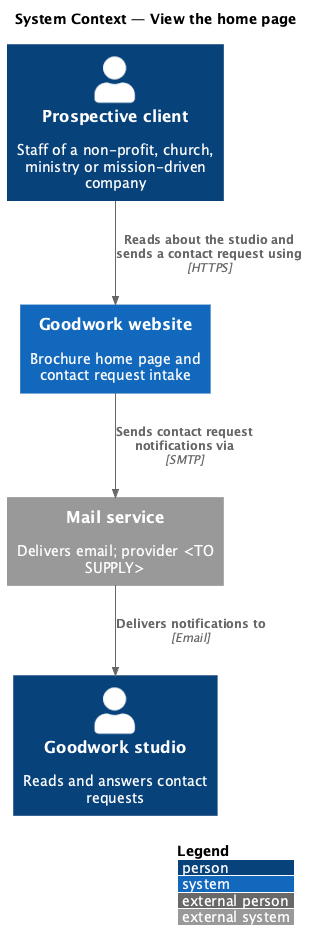
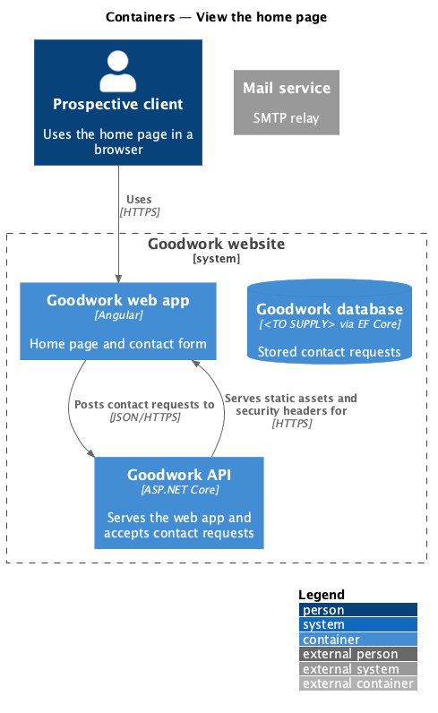
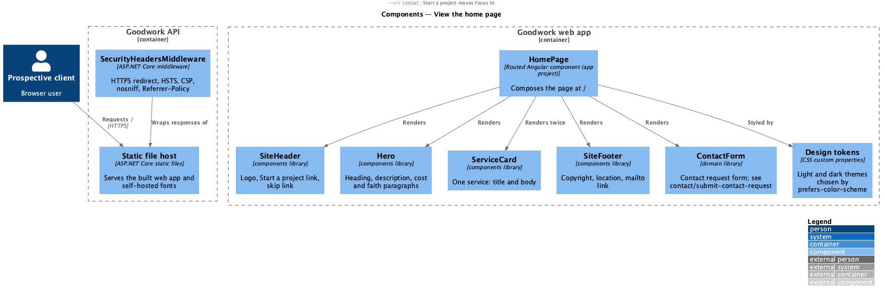
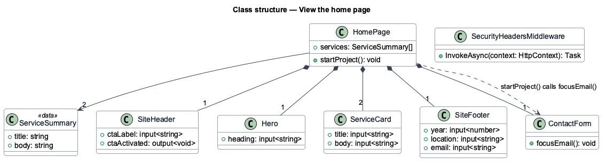
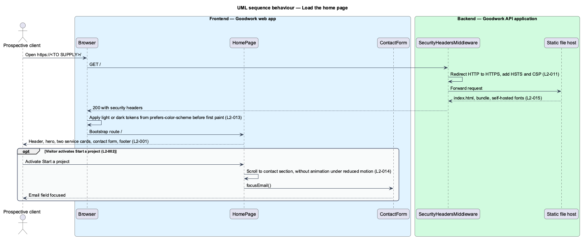

# View the home page

## Overview

Goodwork is a small software studio that builds websites and custom applications for non-profits, churches and ministries, and mission-driven companies. The Goodwork website is a single public page that introduces the studio to these prospective clients.

**home page** — public page at `/` that describes the studio, its services and its contact form

**service card** — panel naming one service the studio offers, with a short description

This feature covers everything a visitor sees when the page loads: the header, the hero text, the two service cards and the footer. It also covers the cross-cutting qualities of that page: responsive layout, light and dark themes, accessibility, transport security headers and load performance. The contact form sits inside the page but has its own feature, `contact/submit-contact-request`.

The page requires no sign-in and fetches no data. It renders complete on first paint. For that reason it has no loading or empty state.

The design reference is `docs/mocks/pages/home/default.html`.

## Description

The slice runs from the ASP.NET Core host that serves the built Angular app to the components that compose the page.

- **`HomePage`** — routed component in the `goodwork` application project. It composes the page and owns the `startProject()` handler, which scrolls to the contact section and calls `ContactForm.focusEmail()`.
- **`ServiceSummary`** — data shape holding a service title and body. The two summaries are static copy taken from the mock.
- **`SiteHeader`** — presentational component in the `components` library. It renders the Cornerstone logo, the "Skip to content" link and the "Start a project" link, and emits `ctaActivated`.
- **`Hero`** — presentational component in `components`. It renders the single `h1` and the description paragraphs projected into it.
- **`ServiceCard`** — presentational component in `components`. It renders one service title and body.
- **`SiteFooter`** — presentational component in `components`. It renders the copyright year, the location and the studio email as a `mailto:` link.
- **`ContactForm`** — component in the `domain` library, described in `contact/submit-contact-request`.
- **Design tokens** — CSS custom properties copied from the design system. The dark palette applies under `prefers-color-scheme: dark` with no script, so no light flash occurs.
- **`SecurityHeadersMiddleware`** — ASP.NET Core middleware in `Goodwork.Api`. It adds HSTS, a Content-Security-Policy without inline script, `X-Content-Type-Options: nosniff` and `Referrer-Policy: strict-origin-when-cross-origin`.
- **Static file host** — the ASP.NET Core static file pipeline. It serves the production build and the self-hosted Inter and Source Serif 4 fonts.

The studio location, contact email and production host name are placeholders in the mocks and remain `<TO SUPPLY>`.

## Requirements

The feature realizes the following level-2 (L2) requirements. Each L2 requirement refines a level-1 (L1) requirement, cited by identifier.

| L2 ID | Refines (L1) | Requirement |
|-------|--------------|-------------|
| `L2-001` | `L1-001` | The page at `/` shall render, without signing in, the header, hero, two service cards, contact section and footer, with copy matching the mock. |
| `L2-002` | `L1-001` | "Start a project" shall scroll to the contact form and focus the email field, and a "Skip to content" link shall be the first focus stop. |
| `L2-011` | `L1-004` | The site shall enforce HTTPS with HSTS and send a Content-Security-Policy, `nosniff` and `Referrer-Policy` header on every response. |
| `L2-012` | `L1-005` | The page shall lay out correctly from below 576px to 1200px and wider, with no horizontal scroll, and shall be no taller than 1100px at 1280×800. |
| `L2-013` | `L1-005` | The page shall follow the operating system's light or dark preference with no flash, and every pair shall meet WCAG 2.2 AA contrast. |
| `L2-014` | `L1-006` | The page shall meet WCAG 2.2 AA in every state, including keyboard order, visible focus, announcements, heading order and reduced motion. |
| `L2-015` | `L1-007` | The page shall reach LCP under 2.5 s, CLS under 0.1 and INP under 200 ms on a mid-range phone over 4G, with initial JavaScript under 200 KB and self-hosted fonts. |

`L2-011` is shared with `contact/deliver-contact-request`, which covers its logging and retention criteria.

## Diagrams

### System context

A prospective client reads about the studio on the Goodwork website. The website sends contact requests to the studio through an external mail service.

### Containers

The Goodwork API hosts the built Goodwork web app and adds security headers to every response. The page itself makes no API call until a contact request is sent.

### Components

`HomePage` composes four `components` library parts and the `ContactForm` from the `domain` library. On the server, `SecurityHeadersMiddleware` wraps the static file host.

### Class structure

`HomePage` owns one header, one hero, two service cards, one contact form and one footer. `startProject()` depends on `ContactForm.focusEmail()`.

### Behaviour — load the home page

The browser receives the app with security headers, applies the theme before first paint and renders every section. The optional block shows the "Start a project" shortcut.

